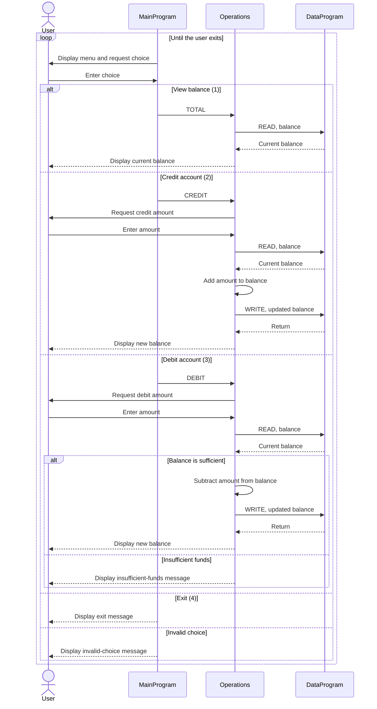

# COBOL Account Management System

## Purpose

This directory documents the COBOL account-management example in `src/cobol`. The program provides a console menu to view one account balance, credit the account, or debit it.

Despite the training exercise's student-account context, the current implementation does not model individual students. It has one shared balance and no student identifiers, account ownership, tuition, fees, or student-specific eligibility rules.

## Source Files

### `src/cobol/main.cob` - `MainProgram`

Runs the interactive menu and dispatches each selection to `Operations`:

- `1`: view the balance (`TOTAL`)
- `2`: credit the account (`CREDIT`)
- `3`: debit the account (`DEBIT`)
- `4`: exit the program

Any other menu choice displays an invalid-choice message.

### `src/cobol/operations.cob` - `Operations`

Implements the account actions and interacts with `DataProgram`. Operation codes are passed in six-character fields, with shorter values padded with trailing spaces:

- **View (`TOTAL`):** reads and displays the current balance.
- **Credit (`CREDIT`):** accepts an amount, reads the balance, adds the amount, writes the updated balance, and displays it.
- **Debit (`DEBIT`):** accepts an amount and compares it with the current balance. If the balance is at least the requested amount, it subtracts and saves the amount; otherwise, it reports insufficient funds and leaves the balance unchanged.

### `src/cobol/data.cob` - `DataProgram`

Provides the balance storage interface. A `READ` operation copies its stored balance to the caller, and a `WRITE` operation replaces the stored balance with the caller's value. The balance starts at `1000.00` and is held in working storage, so it is not persisted between program runs.

## Business Rules and Current Limitations

- The starting balance is `1000.00`.
- A debit is accepted only when the current balance is greater than or equal to the debit amount; insufficient funds leave the balance unchanged.
- Credits have no upper limit or other business validation in the current code.
- Credit and debit amounts are not checked for positivity. As written, a negative credit reduces the balance, and a negative debit can increase it.
- Amounts and balances use a numeric field with two implied decimal places (`PIC 9(6)V99`).
- The application manages only one balance. There is no student record, per-student account, transaction history, or persistent storage.

## Application Sequence

